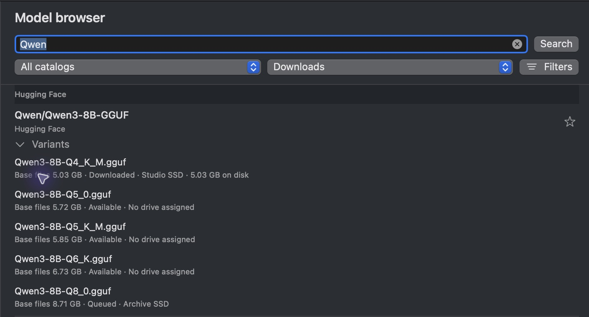
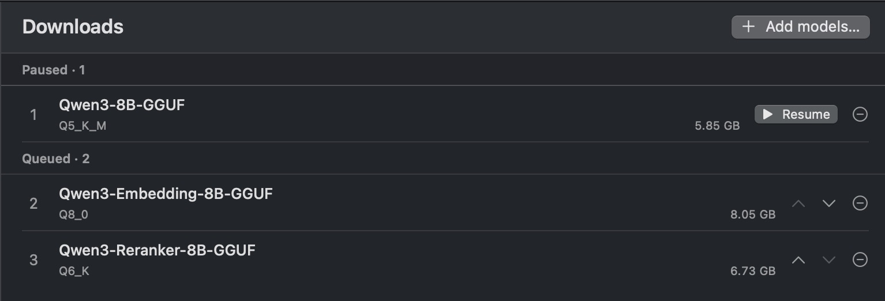
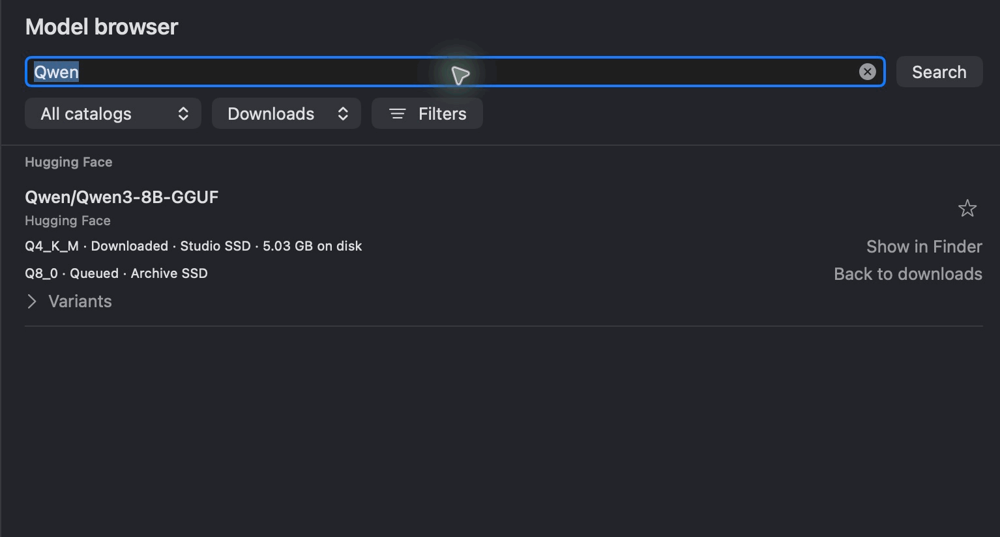

# BentoDisk

**English** · [Русский](README.ru.md)

**Find the model you already downloaded.**

BentoDisk is a macOS app for browsing, downloading, and organizing local AI models. Search for a model, compare variants, and see which ones are already on your Mac or an external drive before downloading again.

## Download

Get the DMG from [GitHub Releases](https://github.com/Perebevaska/bentodisk/releases). Open it and drag **BentoDisk** into **Applications**.

BentoDisk supports **macOS 14 or later** on **Apple Silicon and Intel**. The app includes Python. Preview builds use an ad hoc signature. If macOS asks you to confirm the first launch, follow [Apple’s instructions](https://support.apple.com/en-us/102445).

## What you can do

- **Find GGUF and MLX variants.** Check their size, download state, storage location, and whether a vision projector is available before starting a transfer.
- **See what is on each drive.** Browse downloaded models and planned destinations on connected volumes. BentoDisk can read model locations configured in LM Studio and Strata.
- **Keep browsing while downloads run.** Select multiple models, add them to the end of the queue, and pause or resume individual transfers.

## Screenshots





The screenshots and demo use sample storage and queue data.

<details>
<summary>Watch the 20-second demo</summary>



</details>

## Build from source

On a Mac with Xcode Command Line Tools, run the following command. It downloads the pinned Sparkle and CPython dependencies, then builds and verifies a universal DMG in `dist/`.

```sh
bash packaging/build-dmg.sh
```

To run the offline tests:

```sh
/usr/bin/python3 -B -m unittest discover -s tests
```

## Feedback

Tell us which catalog, model variant, or storage layout BentoDisk missed. Include your macOS version and the model repository, and remove personal paths from screenshots. [Open an issue](https://github.com/Perebevaska/bentodisk/issues/new).

## License

BentoDisk is licensed under the [MIT License](LICENSE). Bundled third-party components retain their own licenses.
