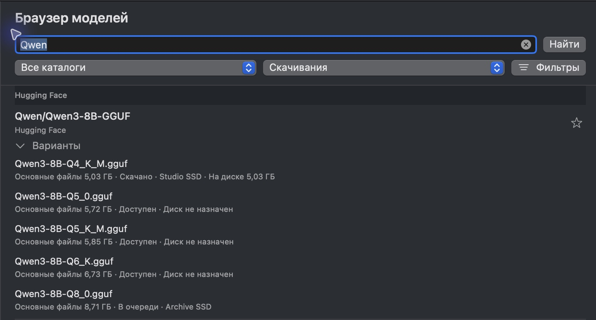
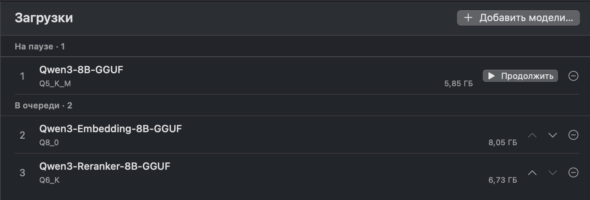

# BentoDisk

[English](README.md) · **Русский**

**Загрузчик LLM и других локальных ИИ-моделей для macOS.**

BentoDisk ищет модели в Hugging Face, ModelScope, LM Studio и Ollama Library из одного окна. Сравнивайте варианты, смотрите, какие файлы уже есть на Mac или внешних дисках, и скачивайте недостающие на выбранный диск.

[**Скачать для macOS**](https://github.com/Perebevaska/bentodisk/releases) · macOS 14 и новее · Apple Silicon и Intel



## От поиска до файлов на диске

1. **Найдите модель.** Ищите по всем каталогам или выберите один. Можно вставить ссылку на модель, посмотреть популярные варианты и тренды, если источник публикует такие рейтинги.
2. **Выберите файлы.** Сравните форматы, квантизации и размеры. Проверьте, какие варианты уже скачаны, есть ли проектор для работы с изображениями и сколько свободного места на выбранном диске.
3. **Выберите, где хранить модель.** Скачайте её на внутренний или внешний диск либо добавьте в «Избранное» и укажите место будущей загрузки. BentoDisk группирует папки моделей по назначению.
4. **Управляйте очередью.** Добавляйте несколько моделей во время загрузки. Ставьте загрузки на паузу и продолжайте их. BentoDisk может использовать уже скачанные файлы после проверки.



На скриншотах и в демо показаны тестовые диски и очередь.

## Каталоги и форматы

| Каталог | Что скачивает BentoDisk |
| --- | --- |
| Hugging Face | Файлы выбранной ревизии репозитория, включая варианты GGUF и комплекты MLX или Safetensors |
| ModelScope | Файлы выбранного репозитория модели |
| LM Studio | Файлы из репозиториев Hugging Face, на которые ссылается каталог LM Studio |
| Ollama Library | Файлы для тегов, у которых опубликованы локальные веса |

BentoDisk также находит модели в папках, заданных в настройках LM Studio и Strata. Помимо LLM для чата и кода, можно искать модели для эмбеддингов, анализа и генерации изображений, работы со звуком и видео. Запускать скачанные модели можно в среде, которая поддерживает их формат.

## Установка

Откройте DMG и перетащите **BentoDisk** в папку **«Программы»**. Python уже встроен. Предварительные сборки подписаны локально. Если macOS попросит подтвердить первый запуск, воспользуйтесь [инструкцией Apple](https://support.apple.com/ru-ru/102445).

<details>
<summary>Смотреть 20-секундное демо на английском</summary>


</details>

## Сборка из исходников

На Mac с Xcode Command Line Tools выполните команду ниже. Она скачает закреплённые версии Sparkle и CPython, соберёт универсальный DMG и проверит его. Готовый образ появится в папке `dist/`.

```sh
bash packaging/build-dmg.sh
```

Запустите автономные тесты следующей командой.

```sh
/usr/bin/python3 -B -m unittest discover -s tests
```

## Обратная связь

Если BentoDisk пропустил каталог, вариант модели или папку на диске, укажите версию macOS и ссылку на репозиторий модели. Перед отправкой скриншота скройте личные пути. [Создать issue](https://github.com/Perebevaska/bentodisk/issues/new).

## Лицензия

BentoDisk распространяется по [лицензии MIT](LICENSE). Встроенные сторонние компоненты сохраняют свои лицензии.
