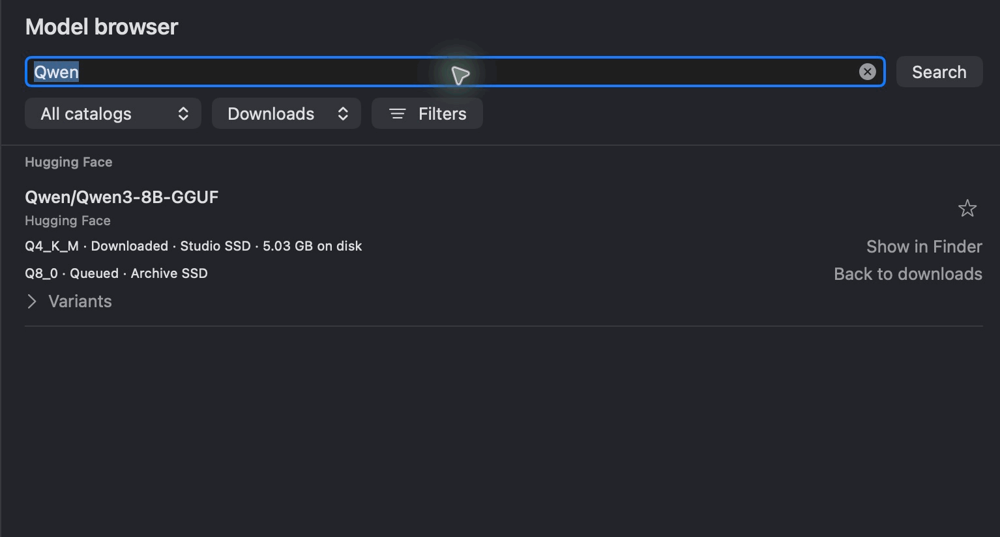

# BentoDisk

[English](README.md) · **Русский**

**Найдите модель, которую уже скачали.**

BentoDisk — приложение для macOS, в котором можно искать, скачивать и хранить локальные ИИ-модели. Найдите нужную модель, сравните варианты и проверьте, что уже есть на Mac или внешнем диске.

## Скачать

Скачайте DMG из [GitHub Releases](https://github.com/Perebevaska/bentodisk/releases). Откройте образ и перетащите **BentoDisk** в папку **«Программы»**.

BentoDisk работает на **macOS 14 и новее** на **Apple Silicon и Intel**. Python уже встроен в приложение. Предварительные сборки подписаны локально. Если macOS попросит подтвердить первый запуск, воспользуйтесь [инструкцией Apple](https://support.apple.com/ru-ru/102445).

## Возможности

- **Сравнивайте варианты GGUF и MLX.** Перед загрузкой видны размер, статус, расположение и наличие проектора для работы с изображениями.
- **Смотрите модели по дискам.** BentoDisk показывает скачанные модели и запланированные места хранения на подключённых дисках и учитывает папки моделей из настроек LM Studio и Strata.
- **Пользуйтесь каталогом во время загрузок.** Выбирайте сразу несколько моделей, добавляйте их в конец очереди и приостанавливайте или продолжайте отдельные загрузки.

## Скриншоты


На скриншотах и в демо показаны тестовые диски и очередь.

<details>
<summary>Смотреть 20-секундное демо на английском</summary>



</details>

## Сборка из исходников

На Mac с Xcode Command Line Tools выполните команду ниже. Она скачает закреплённые версии Sparkle и CPython, соберёт универсальный DMG и проверит его. Готовый образ появится в папке `dist/`.

```sh
bash packaging/build-dmg.sh
```

Запустите автономные тесты следующей командой.

```sh
/usr/bin/python3 -B -m unittest discover -s tests
```

## Обратная связь

Если BentoDisk пропустил каталог, вариант модели или папку на диске, укажите версию macOS и ссылку на репозиторий модели. Перед отправкой скриншота скройте личные пути. [Создать issue](https://github.com/Perebevaska/bentodisk/issues/new).

## Лицензия

BentoDisk распространяется по [лицензии MIT](LICENSE). Встроенные сторонние компоненты сохраняют свои лицензии.
